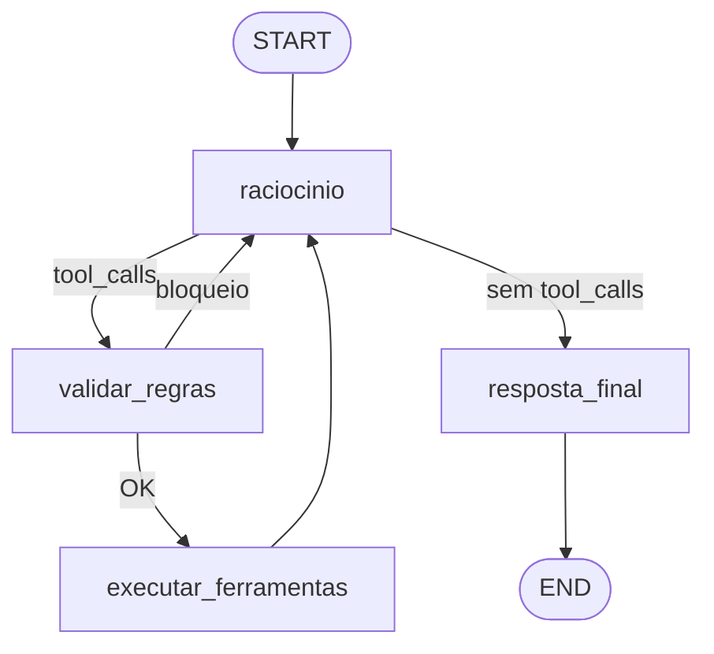

# CrediSentinela · Projeto Avaliativo Agentes de IA — SCTEC

[](https://www.python.org/)
[](https://fastapi.tiangolo.com/)
[](https://langchain-ai.github.io/langgraph/)
[](https://sctec.scti.sc.gov.br/)

**Agente de IA para Customer Success B2B** que interpreta linguagem natural, consulta empresas/assinaturas na API SaaS e inclui créditos extras de API com validação de regras de negócio.

> Projeto avaliativo — **SCTEC · CT Aperfeiçoar | Agentes de IA T1**  
> Autor: **Julio Cesar Bueno de Oliveira**

---

## Visão geral

| Pasta | Papel |
|-------|--------|
| [`api-saas/`](./api-saas) | Sistema base (FastAPI + PostgreSQL + Docker): empresas, assinaturas e créditos |
| [`saas-agent/`](./saas-agent) | **CrediSentinela** — agente LangChain/LangGraph + API FastAPI + interface web |

Fluxo típico:

```text
Analista (linguagem natural)
    → Interface web / Swagger (saas-agent :8010)
        → Grafo LangGraph (raciocinio → validar_regras → executar_ferramentas → resposta_final)
            → API SaaS (api-saas :8002)
```

Exemplo de solicitação:

> *“Consulte a assinatura da empresa Logística Sul e adicione 1.500 créditos extras de API”*

---

## Regras de negócio (CrediSentinela)

- Incluir créditos **somente** se a assinatura estiver **ATIVA**
- Teto de **3.000 créditos extras** por operação
- Tratar empresa inexistente e **ambiguidade** de nome
- Recusar fora de escopo (cancelar assinatura, mudar plano, estorno)
- Resistência básica a prompt injection sobre o limite de créditos

---

## Arquitetura do agente



| Tool | Endpoint SaaS |
|------|----------------|
| `search` | `GET /empresas?nome=...` |
| `lookup` | `GET /assinaturas/{empresa_id}` |
| `credit` | `POST /assinaturas/{id}/creditos` |

Documentação detalhada do agente: **[saas-agent/README.md](./saas-agent/README.md)**

---

## Pré-requisitos

- Docker + Docker Compose
- Python 3.11+
- Chave [Groq](https://console.groq.com/keys)

---

## Como executar

### 1. API SaaS base

```bash
cd api-saas
docker compose up -d --build
curl http://localhost:8002/health
```

Swagger do SaaS: http://localhost:8002/docs  

Dados de seed (exemplos):

| Empresa | Status | Uso nos testes |
|---------|--------|----------------|
| Logística Sul | ATIVA | Fluxo nominal |
| TechFlow Soluções | INATIVA | Recusa por status |
| Alpha Varejo Brasil / Alpha Cloud | ATIVA | Ambiguidade “Alpha” |

### 2. CrediSentinela (agente)

```bash
cd saas-agent
python -m venv .venv
# Windows: .venv\Scripts\activate
# Linux/macOS: source .venv/bin/activate
pip install -r requirements.txt
cp .env.example .env
# Preencha GROQ_API_KEY no .env
uvicorn api.main:app --host 127.0.0.1 --port 8010 --reload
```

| Recurso | URL |
|---------|-----|
| Interface web | http://127.0.0.1:8010/ |
| Swagger | http://127.0.0.1:8010/docs |
| Health | http://127.0.0.1:8010/health |
| Executar | `POST /agent/executar` |

```bash
# Demo CLI dos 3 cenários
python run_demo.py
```

Variáveis principais (`.env` em `saas-agent/`):

```env
GROQ_API_KEY=
LLM_MODEL=openai/gpt-oss-120b
SAAS_API_BASE_URL=http://localhost:8002
AGENT_MAX_ITERATIONS=10
```

---

## Cenários de teste (mínimo 3)

1. **Nominal** — Logística Sul + inclusão ≤ 3000 créditos → sucesso  
2. **Erro / ambiguidade** — empresa inexistente ou nome ambíguo → resposta clara, sem quebrar  
3. **Regra / escopo** — > 3000 créditos, assinatura inativa ou “cancele a assinatura” → recusa  

Evidências e JSONs de exemplo: [saas-agent/README.md](./saas-agent/README.md#cenários-de-teste-mínimo-3)

---

## Estrutura do repositório

```text
ProjetoAvaliativoAgentesIA_SCTec/
├── api-saas/                 # Sistema base (Docker + FastAPI + PostgreSQL)
├── saas-agent/               # CrediSentinela
│   ├── agent/                # state, prompts, tools, graph
│   ├── api/                  # FastAPI do agente
│   ├── frontend/             # Interface web
│   ├── evidence/             # Script de demonstração
│   ├── tests/
│   ├── requirements.txt
│   ├── pyproject.toml
│   └── README.md             # Documentação completa do agente
├── setup.py
└── README.md                 # Este arquivo
```

---

## Stack

- **LangChain** + **LangGraph** + **langchain-groq**
- **FastAPI** / Uvicorn / Pydantic / httpx
- **PostgreSQL** (api-saas via Docker)

---

## Licença / uso acadêmico

Material desenvolvido para fins avaliativos no programa **SCTEC**.  
API SaaS base inspirada/derivada do material institucional do curso.

---

**CrediSentinela** — consulta segura, créditos sob controle.

Julio Cesar Bueno de Oliveira
