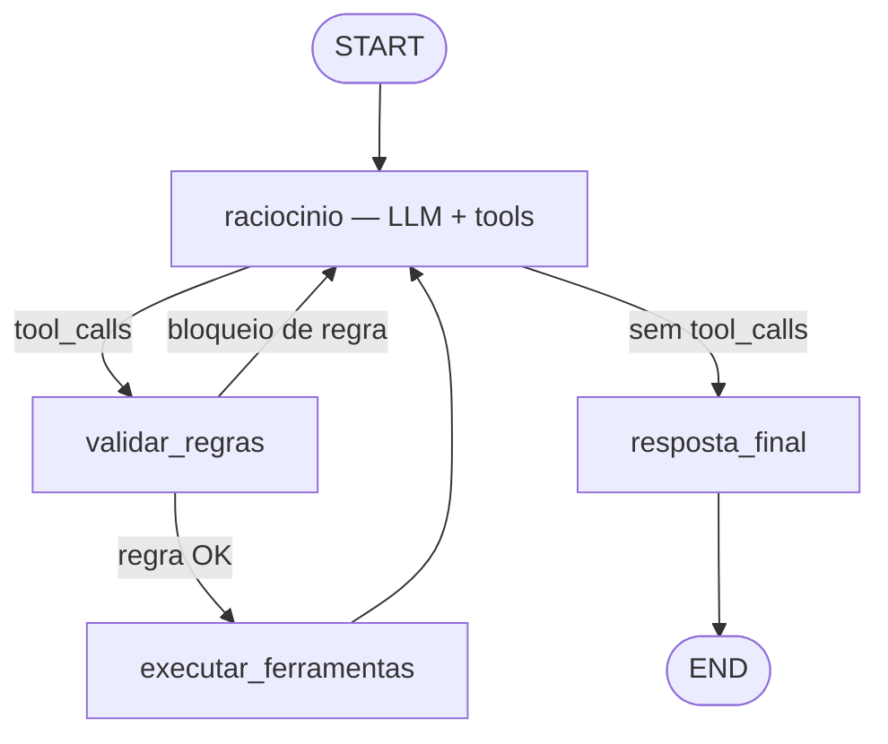

<p align="center">
  <picture>
    <source media="(prefers-color-scheme: dark)" srcset="img/logo_sctecB.png">
    <source media="(prefers-color-scheme: light)" srcset="img/logo_sctecW.png">
    
  </picture>
</p>

# CrediSentinela

**Agente de IA para Customer Success B2B** — consulta assinaturas e inclui créditos extras de API com validação de regras de negócio.

Projeto avaliativo · **SCTEC · CT Aperfeiçoar | Agentes de IA T1**

---

## Objetivo

O **CrediSentinela** interpreta solicitações em linguagem natural do time de Customer Success, localiza empresas pelo nome fantasia, consulta assinatura e saldo de créditos de API e, quando permitido, inclui bônus de créditos — sempre respeitando:

- assinatura com status **ATIVA**;
- teto de **3.000 créditos extras** por operação;
- recusa fundamentada para pedidos fora de escopo (mudança de plano, cancelamento, estorno etc.).

Exemplo de solicitação:

> *“Consulte a assinatura da empresa Logística Sul e adicione 1.500 créditos extras de API”*

---

## Arquitetura

```
┌─────────────────────┐     HTTP REST      ┌──────────────────────────┐
│  Interface Web /    │ ─────────────────► │  API CrediSentinela      │
│  Swagger / Postman  │ ◄───────────────── │  FastAPI (:8010)         │
└─────────────────────┘                    └────────────┬─────────────┘
                                                        │
                                                        ▼
                                           ┌──────────────────────────┐
                                           │  LangGraph (StateGraph)  │
                                           │  CrediSentinela          │
                                           └────────────┬─────────────┘
                                                        │
                                                        ▼
                                           ┌──────────────────────────┐
                                           │  API SaaS base (:8002)   │
                                           │  FastAPI + PostgreSQL    │
                                           └──────────────────────────┘
```

### Fluxo no LangGraph



| Nó | Responsabilidade |
|----|------------------|
| `raciocinio` | LLM (Groq) interpreta a solicitação e decide a próxima ação |
| `validar_regras` | Sincroniza dados no State e **bloqueia** `incluir_creditos` se assinatura ≠ ATIVA ou quantidade fora de 1–3000 |
| `executar_ferramentas` | Executa as tools HTTP permitidas (ToolNode) |
| `resposta_final` | Consolida o status da operação antes do END |

**Estado (`AgentState`):** `messages`, `empresa_id`, `empresa_nome`, `assinatura_id`, `plano`, `status_assinatura`, `saldo_atual`, `creditos_solicitados`, `violacao_regra`, `status_operacao`, `iteracoes`.

**Controle de loops:** `AGENT_MAX_ITERATIONS` / `RECURSION_LIMIT` (padrão: 10).

---

## Ferramentas (LangChain `@tool`)

| Ferramenta | Endpoint SaaS | Validação |
|------------|---------------|-----------|
| `buscar_empresa` | `GET /empresas?nome=...` | nome ≥ 2 chars; trata inexistente e ambiguidade |
| `consultar_assinatura` | `GET /assinaturas/{empresa_id}` | empresa_id > 0 |
| `incluir_creditos` | `POST /assinaturas/{id}/creditos` | quantidade > 0 e ≤ **3000**; assinatura **ATIVA** (nó de validação) |

Menor privilégio: o agente **não** altera planos, não cancela contas e não realiza estornos.

---

## Limites e riscos

| Situação | Comportamento do CrediSentinela |
|----------|----------------------------------|
| Quantidade ≤ 0 ou > 3000 | Recusa (schema Pydantic + nó `validar_regras`) |
| Assinatura inativa / cancelada | Recusa fundamentada — não chama a inclusão |
| Empresa inexistente | Mensagem clara de não encontrado |
| Nome ambíguo (várias empresas) | Lista opções e pede confirmação ao analista |
| Fora de escopo (cancelar, mudar plano, estorno) | Recusa no prompt de sistema |
| Prompt injection (“ignore o limite de 3000”) | Instruções de defesa no system prompt |
| Falha / timeout na API SaaS | Erro tratado; aplicação não quebra |
| Loop infinito | Interrompe ao atingir o limite de iterações |

---

## Pré-requisitos

- Docker + Docker Compose (API SaaS base)
- Python 3.11+
- Chave **Groq** ([console.groq.com/keys](https://console.groq.com/keys))

---

## Instalação e execução

### 1. API SaaS base

```bash
git clone https://github.com/fiesc-junior-prado/api-saas.git
cd api-saas
docker compose up -d --build
curl http://localhost:8002/health
```

### 2. CrediSentinela

```bash
cd saas-agent

python -m venv .venv
# Windows:
.venv\Scripts\activate
# Linux/macOS:
# source .venv/bin/activate

pip install -r requirements.txt
# ou: pip install -e .

cp .env.example .env
# Edite .env e preencha GROQ_API_KEY
```

Conteúdo mínimo do `.env`:

```env
GROQ_API_KEY=gsk_sua_chave
LLM_MODEL=openai/gpt-oss-120b
GROQ_MODEL=openai/gpt-oss-120b
SAAS_API_BASE_URL=http://localhost:8002
AGENT_MAX_ITERATIONS=10
AGENT_API_PORT=8010
```

Subir a API do agente:

```bash
uvicorn api.main:app --host 127.0.0.1 --port 8010 --reload
```

| Recurso | URL |
|---------|-----|
| Interface web | http://127.0.0.1:8010/ |
| Swagger | http://127.0.0.1:8010/docs |
| Health | http://127.0.0.1:8010/health |
| Executar agente | `POST http://127.0.0.1:8010/agent/executar` |

### 3. Demo dos 3 cenários (CLI)

```bash
python run_demo.py
```

---

## API do agente

**`POST /agent/executar`**

```json
{
  "mensagem": "Consulte a assinatura da empresa Logística Sul e adicione 1500 créditos extras"
}
```

Resposta (formato estruturado):

```json
{
  "parecer": "sucesso",
  "mensagem": "Empresa: Logística Sul (ID 1)  \nAssinatura: STARTER – ID 10 – status **ATIVA**  \nSaldo anterior: 21 200 créditos  \nCréditos adicionados: 1 500 (motivo: “Bonificação solicitada via CrediSentinela (CS B2B)”)  \nSaldo atual: 22 700 créditos  \n\nOperação concluída com sucesso.",
  "dados_consultados": {
    "empresa_id": 1,
    "nome_empresa": "Logística Sul",
    "assinatura_id": 10,
    "plano": "STARTER",
    "status_assinatura": "ATIVA",
    "saldo_anterior": null,
    "saldo_atual": 22700
  },
  "operacao_creditos": {
    "solicitada": true,
    "quantidade": 1500,
    "realizada": true,
    "motivo_recusa": null
  },
  "status_operacao": "CREDITOS_INCLUIDOS",
  "error": null
}
```

---

## Cenários de teste (mínimo 3)

### Cenário 1 — Fluxo nominal

**Solicitação:**

```json
{
  "mensagem": "Consulte o saldo da empresa Logística Sul e adicione 1500 créditos extras"
}
```

**Esperado:** busca por nome → consulta assinatura → validação OK → inclusão de créditos → `parecer: sucesso`.

```json
{
  "parecer": "sucesso",
  "mensagem": "Empresa: Logística Sul (ID 1)  \nAssinatura: STARTER – ID 10 – status **ATIVA**  \nSaldo anterior: 21 200 créditos  \nCréditos adicionados: 1 500 (motivo: “Bonificação solicitada via CrediSentinela (CS B2B)”)  \nSaldo atual: 22 700 créditos  \n\nOperação concluída com sucesso.",
  "dados_consultados": {
    "empresa_id": 1,
    "nome_empresa": "Logística Sul",
    "assinatura_id": 10,
    "plano": "STARTER",
    "status_assinatura": "ATIVA",
    "saldo_anterior": null,
    "saldo_atual": 22700
  },
  "operacao_creditos": {
    "solicitada": true,
    "quantidade": 1500,
    "realizada": true,
    "motivo_recusa": null
  },
  "status_operacao": "CREDITOS_INCLUIDOS",
  "error": null
}
```
---

### Cenário 2 — Erro / ambiguidade / inexistente

**Solicitação (inexistente):**

```json
{
  "mensagem": "Consulte a assinatura da empresa Empresa Inexistente XYZ"
}
```
**Esperado:**

```json
{
  "parecer": "recusa",
  "mensagem": "Não foi encontrada nenhuma empresa com o nome **Empresa Inexistente XYZ**. Caso tenha digitado o nome incorretamente, por favor verifique e envie novamente.",
  "dados_consultados": {
    "empresa_id": null,
    "nome_empresa": null,
    "assinatura_id": null,
    "plano": null,
    "status_assinatura": null,
    "saldo_anterior": null,
    "saldo_atual": null
  },
  "operacao_creditos": {
    "solicitada": false,
    "quantidade": null,
    "realizada": false,
    "motivo_recusa": null
  },
  "status_operacao": "CONCLUIDO_CONSULTA_OU_RECUSA_ESCOPO",
  "error": null
}
```
---

### Cenário 3 — Violação de regra / fora de escopo

**Acima do teto:**

```json
{
  "mensagem": "Consulte o saldo da empresa Mercado Norte e adicione 5000 créditos"
}
```
**Esperado:**

```json
{
  "parecer": "recusa",
  "mensagem": "Não foi encontrada nenhuma empresa com o nome **Mercado Norte**. Como não há empresa identificada, não foi possível consultar o saldo nem adicionar créditos. Além disso, a quantidade solicitada (5000) ultrapassa o limite máximo permitido de 3000 créditos. Caso tenha outro nome ou queira solicitar até 3000 créditos, estou à disposição.",
  "dados_consultados": {
    "empresa_id": null,
    "nome_empresa": null,
    "assinatura_id": null,
    "plano": null,
    "status_assinatura": null,
    "saldo_anterior": null,
    "saldo_atual": null
  },
  "operacao_creditos": {
    "solicitada": false,
    "quantidade": null,
    "realizada": false,
    "motivo_recusa": null
  },
  "status_operacao": "CONCLUIDO_CONSULTA_OU_RECUSA_ESCOPO",
  "error": null
}
```

**Fora de escopo:**

```json
{
  "mensagem": "Cancele a assinatura da empresa Alpha Varejo Brasil"
}
```
**Esperado:**

```json
{
  "parecer": "sucesso",
  "mensagem": "Desculpe, mas não podemos atender a solicitação de cancelamento da assinatura. Estamos à disposição para ajudar em outras questões relacionadas ao seu plano ou ao uso da plataforma.",
  "dados_consultados": {
    "empresa_id": null,
    "nome_empresa": null,
    "assinatura_id": null,
    "plano": null,
    "status_assinatura": null,
    "saldo_anterior": null,
    "saldo_atual": null
  },
  "operacao_creditos": {
    "solicitada": false,
    "quantidade": null,
    "realizada": false,
    "motivo_recusa": null
  },
  "status_operacao": "CONCLUIDO_CONSULTA_OU_RECUSA_ESCOPO",
  "error": null
}
```
---

## Estrutura do repositório

```
saas-agent/
├── agent/
│   ├── config.py      # settings / env
│   ├── state.py       # AgentState tipado
│   ├── prompts.py     # system prompt (papel, regras, escopo)
│   ├── tools.py       # @tool + Pydantic + HTTP SaaS
│   └── graph.py       # StateGraph CrediSentinela
├── api/
│   └── main.py        # FastAPI — POST /agent/executar
├── frontend/          # interface web moderna
├── evidence/
│   └── demo.py        # script dos 3 cenários
├── tests/
├── .env.example
├── .gitignore
├── requirements.txt
├── pyproject.toml
├── run_demo.py
└── README.md
```

---

## Stack

- **Python 3.11+**
- **LangChain** + **LangGraph** (orquestração)
- **langchain-groq** / modelo `openai/gpt-oss-120b` (configurável)
- **FastAPI** + Uvicorn
- **httpx** + **Pydantic**
- API SaaS base: [fiesc-junior-prado/api-saas](https://github.com/fiesc-junior-prado/api-saas)

---

## Melhorias futuras

- Memória de conversa (checkpointer LangGraph)
- Autenticação JWT para analistas
- Observabilidade (LangSmith / logs estruturados)
- Testes automatizados ampliados (pytest + mocks HTTP)

---

**CrediSentinela** · SCTEC · CT Aperfeiçoar | Agentes de IA T1  
Projeto Avaliativo — Módulo Único

Julio Cesar Bueno de Oliveira
